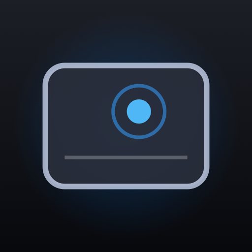
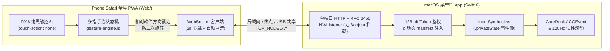

<div align="center">
  
  <h1>AirTrackpad</h1>
  <p><strong>Turn your iPhone into a native-feel Mac trackpad — zero iOS App install, pure tap-to-click ergonomics, 3-finger drag with lift-to-relay, and full 4-finger macOS gestures.</strong></p>
  <p>让你的 iPhone 像 Mac 原生触控板一样操作：无需重度按压、无需安装 iOS App、零第三方依赖。</p>

  <p>
    <a href="https://zou-zhongyuan.github.io/AirTrackpad/"><strong>🌐 在线作品展示与设计博客</strong></a>
    &nbsp;·&nbsp;
    <a href="https://github.com/Zou-Zhongyuan/AirTrackpad/releases/latest"><strong>⬇️ 直接下载 macOS v1.0.0</strong></a>
    &nbsp;·&nbsp;
    <a href="docs/blog-post.md"><strong>📝 独立技术博客文稿</strong></a>
  </p>

  <p>
    <a href="https://github.com/Zou-Zhongyuan/AirTrackpad/actions/workflows/ci.yml">
      
    </a>
    <a href="https://github.com/Zou-Zhongyuan/AirTrackpad/releases/latest">
      
    </a>
    
    
    <a href="LICENSE">
      
    </a>
  </p>
</div>

---

## 为什么做 AirTrackpad？

市面上的远程控制工具（如 Unified Remote）虽然稳定，但手势逻辑更偏向传统鼠标和自定义热键，与 **macOS 原生妙控板** 的肌肉记忆相差较远：例如缺少原汁原味的 **三指拖动短暂抬指接力**、**四指切屏 / 调度中心 / App Exposé / 显示桌面 / 启动台**，以及顺滑的双指自然滚动与缩放。

如果写成原生 iOS App，普通个人开发者账号每 7 天就要重签一次证书。因此 **AirTrackpad** 选择了一条更轻量、开箱即用的路线：

| 对比维度 | AirTrackpad | 传统远程工具（如 Unified Remote） | 侧载原生 iOS App |
| :--- | :--- | :--- | :--- |
| **iPhone 安装成本** | 扫码即用，Safari「添加到主屏幕」即全屏 PWA | 需从 App Store 安装客户端 | 需 Xcode 编译，免费账号每 7 天过期重签 |
| **触控板手势还原度** | 完整对齐 1~4 指原生 Mac 触控板状态机 | 手势有限，偏鼠标按钮模拟 | 可用原生 Touch API，但构建分发重 |
| **三指拖动体验** | 原生级约 `0.4s` 抬指接力 + 单指轻点秒放 | 通常需长按或双指辅助，无接力手感 | 可定制 |
| **物理按压依赖** | **完全不需要按压**（纯轻触 / 多指完成全部操作） | 部分动作依赖点击按键 | 可定制 |
| **配对与安全性** | 128-bit Token + `.local` / 热点 `172.20.10.x` 一键切换 | 局域网广播为主 | 视具体实现 |
| **构建依赖** | **零第三方依赖**（纯 Swift 系统框架 + 原生 ES Module） | 闭源商业软件 | 通常需多端工程 |

---

## 完整手势支持（1~4 指，全程无需用力按压）

| 手指数量 | 手势动作 | Mac 端响应效果 | 细节设计 |
| :---: | :--- | :--- | :--- |
| **1 指** | 移动 | 光标移动 | 非线性加速曲线 + 多屏（含负坐标）边界安全夹紧 |
| **1 指** | 轻点 | 左键单击 / 双击 / 三击 | `230ms` 轻点窗口抗微抖动过滤，不吞快点 |
| **2 指** | 轻点 | 右键单击 | 独立双指点击识别，错峰落指不误发移动 |
| **2 指** | 滑动 | 平滑连续滚动 + 120Hz 惯性滚动 | 默认「自然滚动」（可反转），亚像素余数累加器消除慢滑卡顿 |
| **2 指** | 捏合 / 张开 | 放大 / 缩小页面或图片 | 默认原生 `CGEvent` 手势包络，可选 `IOHID` 缩放或 `⌘+/⌘-` |
| **3 指** | 拖动 | 三指拖动窗口 / 选中文本 | 抬指后保留约 `0.4s`（`0–800ms` 可调）接力续拖，单指轻点立即释放 |
| **3 指** | 轻点 | 查词 / Look Up | 自动查询系统 `Ctrl + ⌘ + D` 符号热键并合成触发 |
| **4 指** | 左右滑动 | 切换桌面空间 | 默认左滑切至右侧空间（可单独反转方向） |
| **4 指** | 上滑 / 下滑 | 调度中心 / App Exposé | 直接调用 `CoreDockSendNotification`（不依赖系统触控板手势开关） |
| **4 指** | 张开 / 捏合 | 显示桌面 / 启动台 (Apps) | 兼容 macOS 14/15 Launchpad 与 macOS 26 Tahoe Apps 视图 |

---

## 快速安装与使用

### 方式一：直接下载安装包（推荐）

1. 前往 [**Releases 最新版本**](https://github.com/Zou-Zhongyuan/AirTrackpad/releases/latest) 下载 `AirTrackpad-v1.0.0-macOS-arm64.zip`。
2. 解压后将 `AirTrackpad.app` 拖入 `/Applications`（应用程序）目录。
3. 本开源版本采用本地 ad-hoc 签名（未经过 Apple Developer 公证），首次打开如提示「无法验证开发者」或「已损坏」，可在终端执行一行清除隔离属性后正常打开：
   ```bash
   xattr -cr /Applications/AirTrackpad.app
   open /Applications/AirTrackpad.app
   ```

### 方式二：从源码一键编译安装（仅需 Command Line Tools，无需完整 Xcode）

```bash
git clone https://github.com/Zou-Zhongyuan/AirTrackpad.git
cd AirTrackpad
./scripts/install-app.sh
```

脚本会自动执行 Release 编译、生成应用与 PWA 图标、校验 `Info.plist`、ad-hoc 签名、安装到 `/Applications/AirTrackpad.app` 并启动。

### 开始配对使用

1. 点击 Mac 顶部菜单栏的 **触控板图标**。
2. 若顶部出现橙色提醒，点击 **「授权辅助功能」** 并在「系统设置 → 隐私与安全性 → 辅助功能」中打开 `AirTrackpad`（仅需一次）。
3. 用 iPhone 相机扫描弹窗二维码在 Safari 中打开；再点击 Safari 底部 **「分享 → 添加到主屏幕」**，之后从桌面图标即可全屏 OLED 黑底秒连。
   - 家庭 / 办公室普通 Wi-Fi 下默认优先使用 `.local` 域名防止路由器重新分配 IP。
   - 若处于屏蔽 mDNS 组播的校园/公司 Wi-Fi，或使用 iPhone 个人热点 / USB 共享网络，直接在 Mac 弹窗的「连接地址」胶囊条点击 `en0` IP 或高亮的 `172.20.10.x` 后再扫码即可。
4. 点击手机端右上角极小设置图标，可随时调节指针灵敏度、滚动速度、自然滚动 / 四指方向、三指接力时长（`0ms–800ms`）以及 **相对软件方向锁定**（支持横放当宽比例触控板，即使手机系统开启着竖屏锁定也不会冲突）。

---

## 系统架构与工程亮点



- **单端口 HTTP + 手写 RFC 6455 WebSocket 服务端**：基于 Apple `Network.framework` 实现，不引入任何第三方库。同时在 `GET /?token=...` 与 `/manifest.json?token=...` 动态注入配对 Token，保证 Safari「添加到主屏幕」持久保留登录态。
- **遵循 Apple TN3179 本地网络隐私规范**：刻意不发布 Bonjour 服务记录，避免 ad-hoc 签名应用在 macOS 15/26 触发本地网络策略拦截；同时由系统 `mDNSResponder` 自动响应 `.local` 解析。
- **Mac 26 Tahoe 实测验证的系统集成**：针对 macOS 26 Tahoe 的 `ControlCenter` 状态栏机制、符号热键 32-bit 掩码 ABI 以及 `CoreDockSendNotification`（含 `com.apple.launchpad.toggle` 在 Tahoe `Apps.app` 中的沿用）均经过真实环境验证。
- **亚像素累加与按客户端所有权释放**：滚动与指针均配备浮点余数累加器防止慢速滑动丢帧；三指拖动强制置 `clickState = 1` 防止接力双击选词，并在任何客户端断连、心跳超时或应用退出时按 `clientID` 精确释放左键。

---

## 目录结构

```
AirTrackpad/
├── Package.swift                  # Swift 6 包定义（零第三方依赖）
├── Sources/
│   ├── AirTrackpadCore/           # 协议编解码、Token、指针数学、滚动累加/惯性、网络发现、HTTP/WebSocket 服务
│   └── AirTrackpadApp/            # 菜单栏 App、CGEvent/CoreDock 输入合成、权限/开机自启、二维码、SwiftUI 弹窗
├── Web/                           # iPhone Safari PWA（OLED 纯黑界面、手势状态机、WebSocket 客户端）
├── docs/                          # GitHub Pages 作品展示页与独立博客文稿
├── Tests/
│   ├── AirTrackpadCoreTests/      # Swift Testing 核心单元与回环 HTTP/WS 集成测试
│   └── js/                        # Node.js ES Module 手势状态机单元测试
└── scripts/
    ├── generate-icons.swift       # 生成 macOS .icns 所需 iconset 与 PWA 图标
    ├── build-app.sh               # Release 编译、打包 .app 与 ad-hoc 签名
    ├── install-app.sh             # 安装到 /Applications 并启动
    └── package-release.sh         # 打包 Release ZIP 与 SHA-256 校验文件
```

---

## 运行自动化测试

### 1. JavaScript 手势状态机测试

```bash
node --check Web/gesture-engine.js && node --check Web/app.js && node --check docs/showcase.js
node --test Tests/js/gesture-engine.test.mjs
```

### 2. Swift 核心与服务端回环测试

- **已安装完整 Xcode**：
  ```bash
  swift test
  ```
- **仅安装 Command Line Tools（无 Xcode）**：
  ```bash
  swift test \
    -Xswiftc -F -Xswiftc /Library/Developer/CommandLineTools/Library/Developer/Frameworks \
    -Xlinker -F -Xlinker /Library/Developer/CommandLineTools/Library/Developer/Frameworks \
    -Xlinker -rpath -Xlinker /Library/Developer/CommandLineTools/Library/Developer/Frameworks \
    -Xlinker -rpath -Xlinker /Library/Developer/CommandLineTools/Library/Developer/usr/lib
  ```

---

## License

[MIT License](LICENSE) © 2026 Zhongyuan Zou
